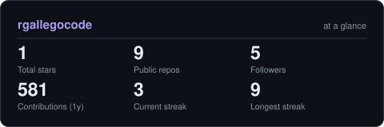

<!-- BANNER - generated from Roberto's profile photo and technical profile. -->
<picture>
  <source media="(prefers-color-scheme: dark)" srcset="assets/banner-dark.v10.svg">
  <source media="(prefers-color-scheme: light)" srcset="assets/banner-light.v10.svg">
  
</picture>

 

<!-- NAME / TAGLINE - animated typing -->

 

<!-- SOCIALS -->
&nbsp;&nbsp;
&nbsp;&nbsp;

 

---

## This is me :)

Hi, I'm **Roberto**, a junior software engineer from Málaga, Spain, focused on **applied AI and backend**. I build LLM agents in Python and backend services in Go and Java, and I like turning messy workflows into software that is easy to test and operate.

- 🤖 **AI & Automation Engineer Intern at DEKRA**: building AI agents with **LangChain, LangGraph and MCP** to automate the analysis of laboratory results.
- 🔗 **Backend developer (Canton/DLT)** in a university-industry collaboration with **IOBuilders**: Go integration with the Canton Ledger API over gRPC, Delivery-versus-Payment settlement and OpenTelemetry observability for a tokenised bond platform.
- 🏆 **4th place in the Betsson challenge at Hackathon UMA 2026** (300+ students): wrote a TypeScript/Playwright tool that validates casino games with computer vision and OCR.
- 🧪 Side project: [**Cava Agent**](https://github.com/rgallegocode/cava-bot), a smolagents ReAct financial-analyst agent with CI on GitHub Actions and a live demo on Hugging Face.
- 🎓 **BSc in Software Engineering at the [University of Málaga](https://www.uma.es/)** (2023–2027) and a 490h University Extension in Blockchain Technologies.
- 🧩 Stack: **Python, Go, Java/Spring Boot, TypeScript**, gRPC, REST, Docker, GitHub Actions.
- 🌍 Spanish (native) · English (C1, Cambridge) · Open to remote (CET).
 

## my perfect stack

---

## signals

<table>
<tr>
<td width="50%" align="center" valign="middle">

<!-- Self-rated radar - edit assets/skills.json, the workflow redraws it -->
<picture>
  <source media="(prefers-color-scheme: dark)" srcset="assets/radar-dark.svg">
  <source media="(prefers-color-scheme: light)" srcset="assets/radar-light.svg">
  
</picture>

</td>
<td width="50%" align="center" valign="middle">

<!-- Hand-authored stack radar - edit assets/langmix.json -->
<picture>
  <source media="(prefers-color-scheme: dark)" srcset="assets/radar-langs-dark.svg">
  <source media="(prefers-color-scheme: light)" srcset="assets/radar-langs-light.svg">
  
</picture>

</td>
</tr>
</table>

---

## My stats

<!-- Generated by scripts/cards.py into this repo. -->
<picture>
  <source media="(prefers-color-scheme: dark)" srcset="assets/card-stats-dark.svg">
  <source media="(prefers-color-scheme: light)" srcset="assets/card-stats-light.svg">
  
</picture>

 

---

` Build carefully · Test relentlessly · Keep learning `

